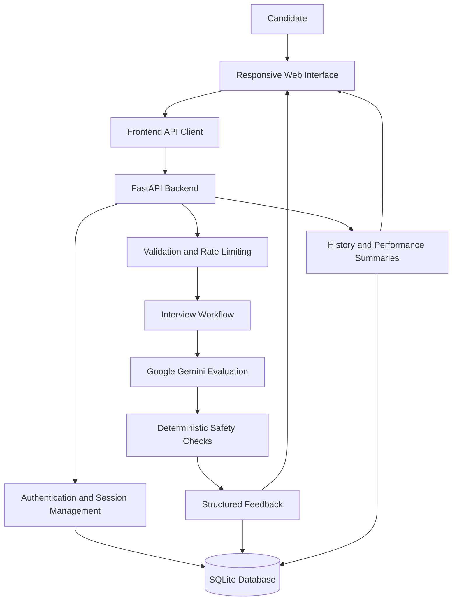

# AI Interview Preparation OS

**Practice interviews. Understand your weaknesses. Improve with every attempt.**

AI Interview Preparation OS is an AI-powered interview practice platform built with Python, FastAPI, JavaScript, and Google Gemini. It helps candidates practice technical and HR interviews, receive structured feedback on their answers, and review their performance across multiple interview sessions.

<p align="center">
  <a href="https://ai-based-interview-simulator-1.onrender.com">
    
  </a>
</p>

<p align="center">
  
  
  
  
  
  
</p>

---

## About the Project

Interview preparation can become repetitive when candidates practice without meaningful feedback or a clear way to track improvement. This project brings interview practice, AI-assisted evaluation, and performance history into a single application.

Candidates can configure an interview, work through questions, review feedback, and revisit previous sessions to understand which areas need more attention.

The goal is straightforward: make interview practice more structured and give candidates useful feedback they can act on.

## Features

### Interview Practice

- Configure the target role, difficulty, interview type, and question count.
- Practice with technical, HR, and AI/ML question banks.
- Track question history to help reduce immediate repetition.
- Use a responsive frontend for the interview workflow.

### Structured AI Feedback

Answers are evaluated using Google Gemini, with feedback organized around four criteria:

| Criterion | What it assesses |
|---|---|
| Technical accuracy | Whether the answer is technically correct. |
| Relevance | Whether the response addresses the question. |
| Clarity | How clearly the candidate explains their reasoning. |
| Completeness | Whether the important parts of the answer are covered. |

Evaluations can also include strengths, weaknesses, supporting evidence, actionable feedback, improved-answer suggestions, confidence indicators, and human-review flags.

Deterministic safety checks complement the AI evaluation workflow. Model-generated feedback is intended to support practice, not replace expert judgment.

### Candidate History and Progress

- Maintain a persistent candidate identity.
- Separate candidate credentials from interview-session credentials.
- Apply session expiration and authorization.
- Review previous interview sessions and candidate-level history.
- Access candidate performance summaries.
- Identify recurring weaknesses across recorded evaluations.

### Backend Reliability

The backend incorporates several practical safeguards and supporting capabilities:

- Request validation and rate limiting.
- `Retry-After` responses when rate limits apply.
- Idempotent evaluation requests using `X-Evaluation-Id`.
- Paginated history retrieval.
- Health and readiness endpoints.
- Safe handling of model-generated content in the frontend.

These features make the project more than a basic AI chat interface: the application also addresses session management, persistence, and predictable request handling.

## How It Works



### Architecture overview

1. **Frontend:** Collects interview configuration and candidate answers, then communicates with the backend through an API client.
2. **FastAPI backend:** Handles application requests, validation, authentication, session management, and interview workflows.
3. **Evaluation layer:** Uses Google Gemini to generate structured feedback, complemented by deterministic safety checks.
4. **Persistence layer:** Uses SQLite for prototype storage of interview-related data and history.
5. **History and summaries:** Makes recorded session information available for reviewing previous attempts and recurring weaknesses.

## Technology Stack

| Technology | Purpose |
|---|---|
| Python | Backend logic and evaluation workflow |
| FastAPI | API development and request handling |
| JavaScript | Frontend interactions and API communication |
| HTML and CSS | Page structure, layout, and responsive styling |
| Google Gemini API | AI-assisted answer evaluation |
| SQLite | Prototype database |
| Pytest | Automated testing |
| Uvicorn | Local FastAPI development server |

## Getting Started

### Prerequisites

- Python 3.10 or later
- A Google Gemini API key for live AI evaluation
- Git and a web browser

### 1. Clone the repository

```bash
git clone <YOUR_REPOSITORY_URL>
cd <YOUR_REPOSITORY_DIRECTORY>
```

Replace the placeholders with your actual repository URL and directory name.

### 2. Set up the backend

```bash
cd Backend

python3 -m venv .venv
source .venv/bin/activate

pip install -r requirements-dev.txt
```

On Windows, activate the virtual environment using:

```powershell
.venv\Scripts\Activate.ps1
```

### 3. Configure environment variables

Create a local environment file:

```bash
cp .env.example .env
```

Add your Gemini API key to `Backend/.env`:

```dotenv
GEMINI_API_KEY=your_gemini_api_key_here
```

Use your own key locally. Never commit real credentials or include them in screenshots, public documentation, or exported project archives.

### 4. Start the backend

From the `Backend/` directory, run:

```bash
uvicorn main:app --reload --port 8000
```

The backend will be available at:

`http://127.0.0.1:8000`

### 5. Open the frontend

The frontend is located in `Frontend/`.

When running the FastAPI server, open:

`http://127.0.0.1:8000/app/`

Alternatively, serve the frontend files through a static HTTP server. If the frontend runs on a separate origin, configure `window.APP_API_URL` before loading `script.js`:

```javascript
window.APP_API_URL = "http://127.0.0.1:8000";
```

Ensure the backend's cross-origin configuration allows the frontend origin when using separate servers.

## Testing

The project includes a deterministic core test suite that uses a fake Gemini client for the mocked AI interactions covered by the tests.

Run the suite from the `Backend/` directory:

```bash
pytest -q tests/test_core.py
```

No real Gemini API key is required for those mocked interactions.

Run the tests in your own environment to check the current state of the codebase; no test count or coverage percentage is claimed here.

## API Reference

| Method | Endpoint | Purpose |
|---|---|---|
| `GET` | `/` | Service information |
| `GET` | `/health` | Liveness check |
| `GET` | `/ready` | Readiness check, including database and Gemini configuration |
| `POST` | `/session/start` | Create an interview session |
| `POST` | `/evaluate` | Evaluate an interview answer |
| `GET` | `/history/{session_id}` | Retrieve session history |
| `GET` | `/history/candidate/{candidate_id}` | Retrieve candidate interview history |
| `GET` | `/history/candidate/{candidate_id}/summary` | Retrieve candidate performance summary |
| `GET` | `/app/` | Serve the bundled frontend |

Evaluation requests support the `X-Evaluation-Id` header for idempotency. History retrieval supports pagination.

Refer to the backend implementation for the exact request schemas, response formats, and authentication requirements.

## Security Considerations

Security is an ongoing engineering responsibility, particularly when an application manages candidate sessions and external AI API credentials.

- Keep `Backend/.env` and API keys out of version control.
- Use `.env.example` as the configuration template.
- Exclude local database files, virtual environments, IDE metadata, and generated caches from commits.
- Rotate any credential that was previously exposed in an exported project archive.
- Treat model-generated feedback as untrusted content and render it safely.
- Review authentication, session expiry, rate limiting, and authorization behavior as the application evolves.

The current implementation uses SQLite as its prototype storage layer. These controls do not, by themselves, establish production readiness or guarantee complete security.

## Limitations and Future Improvements

The current application is a prototype, with several areas worth developing further before a production launch.

| Area | Potential improvement |
|---|---|
| Database | Evaluate PostgreSQL for production workloads and horizontally scaled deployments. |
| Rate limiting | Introduce Redis or another shared store for multiple backend instances. |
| Monitoring | Add centralized logging, monitoring, and operational alerts. |
| Security | Integrate dependency scanning and additional security tests. |
| Testing | Expand browser-based end-to-end testing across complete interview workflows. |
| Evaluation quality | Assess feedback consistency, evidence quality, and usefulness through broader evaluation tests. |
| Deployment | Strengthen deployment configuration and production operational procedures. |

These are proposed improvements, not features claimed to be implemented already.

## Contributing

Contributions that improve the codebase's reliability, usability, maintainability, and evaluation quality are welcome.

1. Fork the repository.
2. Create a branch for your change.
3. Make a focused improvement.
4. Add or update tests where appropriate.
5. Run the relevant test suite.
6. Submit a pull request explaining the change and its rationale.

Please keep credentials, local databases, virtual environments, and generated artifacts out of commits.

## About the Developer

**Ansh Pratap**  
Final-year B.Tech Computer Science and Engineering student at Mewar University.

Interested in software engineering and AI/ML, with a focus on building practical applications that combine AI capabilities with reliable backend systems and thoughtful user experiences.

---

*Built to make interview practice more structured, feedback more actionable, and progress easier to review.*
