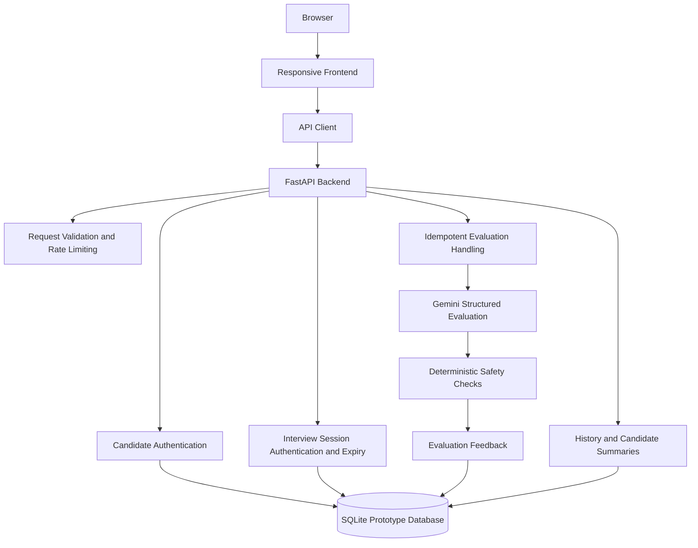

# AI Interview Preparation OS

**An AI-powered interview preparation and evaluation platform built with Python, FastAPI, JavaScript, and Google Gemini.**

AI Interview Preparation OS helps candidates practice interviews, receive structured feedback on their answers, identify recurring weaknesses, and track their interview preparation progress through persistent candidate and session history.

[**Launch AI Interview Preparation OS →**](https://ai-based-interview-simulator-1.onrender.com)

[](https://www.python.org/)
[](https://fastapi.tiangolo.com/)
[](https://developer.mozilla.org/en-US/docs/Web/JavaScript)
[](https://www.sqlite.org/)
[](https://ai.google.dev/)
[](https://docs.pytest.org/)

## Table of Contents

- [Overview](#overview)
- [Key Features](#key-features)
- [Application Architecture](#application-architecture)
- [Technology Stack](#technology-stack)
- [Getting Started](#getting-started)
- [Environment Configuration](#environment-configuration)
- [Running the Application](#running-the-application)
- [Running Tests](#running-tests)
- [API Reference](#api-reference)
- [Engineering and Security](#engineering-and-security)
- [Current Limitations](#current-limitations)
- [Future Improvements](#future-improvements)
- [Contributing](#contributing)
- [Author](#author)

## Overview

Preparing for technical and behavioral interviews requires more than memorizing answers. Candidates need consistent practice, meaningful feedback, an understanding of their weaknesses, and a way to measure their progress over time.

AI Interview Preparation OS brings these activities into one application. Candidates can configure an interview, answer questions, receive AI-assisted evaluations, review previous sessions, and identify areas that require further preparation.

The application combines a responsive frontend with a FastAPI backend, structured Google Gemini evaluations, persistent candidate history, and deterministic safeguards around model-generated feedback.

### What makes this project technically interesting?

- **Structured AI evaluation:** Organizes feedback around technical accuracy, relevance, clarity, and completeness rather than returning an unstructured response alone.
- **Session-aware access:** Separates persistent candidate identity from individual interview-session credentials.
- **Reliable evaluation requests:** Supports idempotent evaluation requests through the `X-Evaluation-Id` header.
- **Longitudinal progress tracking:** Maintains session history and candidate-level summaries to help identify recurring weaknesses.
- **Backend reliability:** Incorporates request validation, rate limiting, pagination, health checks, and readiness checks.
- **Practical testing:** Uses a deterministic test suite with a fake Gemini client to test core behavior without requiring a live AI API call.

## Key Features

### 1. Configurable Interview Practice

- Select a target role.
- Choose interview difficulty and interview type.
- Configure the number of questions.
- Practice using technical, HR, and AI/ML question banks.
- Track question history to reduce immediate repetition.
- Use a responsive interface across supported screen sizes.

### 2. AI-Powered Answer Evaluation

Google Gemini provides structured evaluations of candidate answers.

Evaluation criteria include:

- **Technical accuracy:** Correctness of the concepts and information presented.
- **Relevance:** How closely the answer addresses the question.
- **Clarity:** How clearly the candidate communicates the response.
- **Completeness:** How thoroughly the answer addresses the question.

Evaluation feedback can include:

- Scores across evaluation criteria.
- Identified strengths and weaknesses.
- Supporting evidence from the answer.
- Actionable feedback.
- Suggestions for improved answers.
- Confidence indicators.
- Flags indicating when human review is appropriate.

Deterministic safety checks complement the model-generated evaluation. AI-generated feedback should be treated as preparation guidance rather than a definitive judgment of a candidate's abilities.

### 3. Candidate Identity and Session Management

The application supports candidate-level continuity across interview sessions.

- Persistent candidate identity.
- Separate candidate and interview-session credentials.
- Interview-session expiration and authorization.
- Individual interview-session history.
- Candidate-level interview history.
- Candidate performance summaries.
- Tracking of recurring weaknesses.

This separation helps distinguish a candidate's ongoing preparation history from the credentials and lifecycle of an individual interview session.

### 4. Backend Reliability

The backend includes several mechanisms designed to improve request handling and application behavior.

| Capability | Purpose |
|---|---|
| Request validation | Checks incoming requests before processing. |
| Rate limiting | Restricts excessive requests and supports `Retry-After` responses. |
| Evaluation idempotency | Uses `X-Evaluation-Id` to support duplicate-request handling. |
| Pagination | Supports retrieving history in manageable portions. |
| Health endpoint | Exposes a liveness check. |
| Readiness endpoint | Checks database availability and Gemini configuration. |
| Safe feedback rendering | Helps prevent unsafe HTML interpretation of model-generated content. |
| Persistent storage | Uses SQLite for prototype data storage. |

## Application Architecture

The application follows a frontend-to-backend architecture. The frontend communicates with the FastAPI backend through an API client, while the backend coordinates authentication, request handling, AI evaluation, and persistence.



### Request and evaluation flow

1. The candidate configures an interview through the frontend.
2. The frontend sends requests to the FastAPI backend through the API client.
3. The backend validates requests and applies the relevant authentication, authorization, and rate-limiting controls.
4. Interview answers are processed through the evaluation workflow.
5. Google Gemini generates structured evaluation feedback, with deterministic safety checks applied as part of the evaluation process.
6. The application stores relevant interview data and makes history and candidate summaries available through its API.

SQLite currently serves as the prototype storage layer. Production-scale deployment would require additional infrastructure and operational safeguards.

## Technology Stack

| Technology | Role |
|---|---|
| Python | Backend application logic and evaluation workflow. |
| FastAPI | REST API, request handling, validation, and backend routing. |
| JavaScript | Frontend interaction and API communication. |
| HTML | Frontend page structure. |
| CSS | Responsive interface styling. |
| SQLite | Prototype persistence for application data. |
| Google Gemini API | AI-assisted structured answer evaluation. |
| Pytest | Automated testing of core application behavior. |
| Uvicorn | Local ASGI server for running FastAPI. |

## Getting Started

Follow these steps to run the application locally.

### Prerequisites

- Python 3.10 or later.
- A Google Gemini API key for live AI evaluation.
- Git, if cloning the repository.
- A terminal and a supported web browser.

### 1. Clone the repository

```bash
git clone <YOUR_REPOSITORY_URL>
cd <YOUR_REPOSITORY_DIRECTORY>
```

Replace the placeholders with your actual GitHub repository URL and directory name.

### 2. Create a virtual environment

Navigate to the backend directory:

```bash
cd Backend
```

Create and activate a virtual environment:

```bash
python3 -m venv .venv
source .venv/bin/activate
```

On Windows, activate the environment with:

```powershell
.venv\Scripts\Activate.ps1
```

### 3. Install dependencies

Install the development and testing dependencies:

```bash
pip install -r requirements-dev.txt
```

### 4. Configure environment variables

Create a local environment file from the supplied template:

```bash
cp .env.example .env
```

Open `Backend/.env` and configure the Gemini API key as described in the next section.

## Environment Configuration

The backend uses environment-based configuration to avoid hardcoding sensitive credentials.

### Required configuration for live AI evaluation

Set the following variable in `Backend/.env`:

```dotenv
GEMINI_API_KEY=your_gemini_api_key_here
```

Replace the placeholder with your own API key. Never publish the real value in source code, screenshots, README examples, or Git history.

Keep `Backend/.env` out of version control and use `Backend/.env.example` as the safe configuration template.

The deterministic core test suite uses a fake Gemini client and does not require a real API key for those tests.

## Running the Application

### Start the backend

From the `Backend/` directory, with the virtual environment activated, run:

```bash
uvicorn main:app --reload --port 8000
```

The development server will listen on port `8000`.

### Access the frontend

The frontend files are located in `Frontend/`.

**Option A: Use the bundled frontend**

Open the application through the FastAPI-served frontend route:

```text
http://127.0.0.1:8000/app/
```

**Option B: Serve the frontend separately**

Use any suitable static HTTP server to serve the files in `Frontend/`. No frontend package manager or build command is specified here.

If the frontend is served from a different origin, configure `window.APP_API_URL` to point to the backend origin before `script.js` loads.

For example, if your local backend is running on port `8000`, the configuration value would be:

```javascript
window.APP_API_URL = "http://127.0.0.1:8000";
```

Place this configuration in the frontend's HTML before the script that loads `script.js`.

When using a separate frontend origin, ensure the backend's cross-origin request settings permit the frontend origin.

### Live Demo

Try the hosted application:

[**Launch AI Interview Preparation OS**](https://ai-based-interview-simulator-1.onrender.com)

The availability of the hosted demo may vary. If it does not respond, try again later or use the local setup instructions above.

## Running Tests

The project includes a deterministic core test suite using a fake Gemini client.

From the `Backend/` directory, activate your virtual environment and run:

```bash
pytest -q tests/test_core.py
```

These tests do not require a real Gemini API key for the mocked AI interactions covered by the suite.

Test results may vary with the current codebase and environment. Run the suite locally to determine the current test status.

## API Reference

The following table documents the supplied application endpoints.

| Method | Endpoint | Purpose |
|---|---|---|
| `GET` | `/` | Returns service information. |
| `GET` | `/health` | Provides a liveness check. |
| `GET` | `/ready` | Checks readiness, including database availability and Gemini configuration. |
| `POST` | `/session/start` | Creates an interview session. |
| `POST` | `/evaluate` | Evaluates an interview answer. |
| `GET` | `/history/{session_id}` | Retrieves interview-session history. |
| `GET` | `/history/candidate/{candidate_id}` | Retrieves candidate-level interview history. |
| `GET` | `/history/candidate/{candidate_id}/summary` | Retrieves a candidate performance summary. |
| `GET` | `/app/` | Serves the bundled frontend. |

### API behavior

- Evaluation requests support the `X-Evaluation-Id` header for idempotency.
- History endpoints support pagination.
- Authentication and authorization depend on the relevant candidate or interview-session credentials.
- Rate limiting may restrict requests and return `Retry-After` information.

For implementation-specific request bodies, response schemas, and authentication requirements, consult the backend source code.

## Engineering and Security

Security and reliability are important considerations in an application that manages candidate sessions and processes model-generated feedback.

### Credential management

- Never commit `Backend/.env` or real API keys.
- Keep credentials out of source files, public logs, and exported archives.
- Use `.env.example` to document configuration without exposing secrets.
- Rotate any credential that was previously included in an exported project archive.

### Data and repository hygiene

- Do not commit local database files.
- Exclude virtual environments, IDE metadata, generated caches, and other machine-specific artifacts.
- Review changes before pushing them to a public repository.
- Avoid storing unnecessary sensitive candidate information.

### Request handling and evaluation

The application incorporates request validation, session authorization, rate limiting, evaluation idempotency, and deterministic safety checks. Model-generated evaluations can still be incorrect or incomplete, so their output should be reviewed critically.

These application controls should not be interpreted as a guarantee of complete security or production readiness.

## Current Limitations

The project is a working prototype intended to demonstrate AI-assisted interview preparation and practical backend engineering.

- **SQLite storage:** The current database layer is suitable for a prototype but is not the preferred choice for every horizontally scaled deployment.
- **External AI dependency:** Live AI evaluation depends on Gemini configuration and service availability.
- **Model variability:** Evaluation feedback can vary and may contain mistakes.
- **Operational hardening:** Production deployment requires further monitoring, infrastructure, and security work.
- **End-to-end verification:** Browser-based end-to-end testing should complement the deterministic backend test suite before a production launch.

## Future Improvements

The following items are proposed improvements, not claims about existing implementation.

- **Production database:** Evaluate migration from SQLite to PostgreSQL for more demanding deployment requirements.
- **Shared rate limiting:** Introduce Redis or another shared store when deploying multiple backend instances.
- **Observability:** Add centralized logging, monitoring, and actionable operational alerts.
- **Security validation:** Introduce dependency scanning and more comprehensive security testing.
- **Browser automation:** Add end-to-end tests covering complete interview workflows.
- **Evaluation quality:** Expand evaluation tests to assess consistency, evidence quality, and feedback usefulness.
- **Deployment readiness:** Strengthen configuration validation, operational documentation, and production deployment procedures.

## Contributing

Contributions that improve reliability, maintainability, accessibility, evaluation quality, and documentation are welcome.

1. Fork the repository.
2. Create a focused feature branch.
3. Make changes consistent with the existing architecture.
4. Add or update tests for behavioral changes.
5. Run the relevant test suite.
6. Submit a pull request describing the change, its rationale, and any known limitations.

Please avoid committing secrets, local database files, virtual environments, or generated artifacts.

## Author

**Ansh Pratap**

Final-year B.Tech Computer Science and Engineering student at Mewar University, with interests in software engineering, Artificial Intelligence, and Machine Learning.

This project reflects a practical interest in building AI-powered applications with structured evaluation workflows, session-aware backend design, persistent history, and automated testing.

---

*AI Interview Preparation OS — a practical project focused on making interview preparation more structured, measurable, and actionable.*
